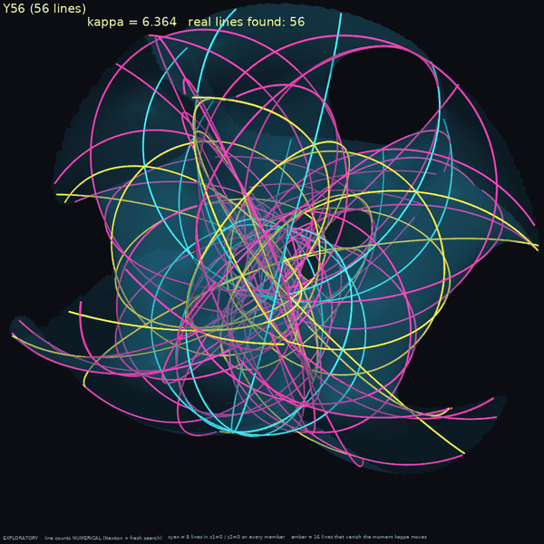

# The quartic surface with the most real straight lines, mapped exactly

**One smooth quartic surface, Y56, holds 56 real straight lines, the most possible, as Degtyarev, Itenberg and Sertöz proved; we list all 56 exactly and show why 16 of them exist at only one setting of a dial in its equation.**

Moki & Julio · 2026 · version 1.0 · DOI [10.5281/zenodo.24406738](https://doi.org/10.5281/zenodo.24406738)

**Read** [PAPER.md](PAPER.md) · **Explore** [the interactive viewer](https://hashirama1337s.github.io/y56-atlas/viewer/) · **Check** [RESULTS.md](RESULTS.md)



*Y56 is bent step by step along a one-dial family of surfaces. The instant it leaves its exact setting, the 16 amber lines vanish together and the real lines drop from 56 to 40; at a wall where the surface pinches at 8 gold points they fall to 24, and only the 8 cyan lines are left at the Fermat-type end. An exploratory rendering; the line counts it shows agree with the exact theorem (video: [media/y56_to_fermat.mp4](media/y56_to_fermat.mp4)).*

## In plain words

A quartic surface is everything that satisfies one polynomial equation of degree 4 in three-dimensional space. Some of these smooth curved surfaces contain perfectly straight lines lying in them from end to end. Degtyarev, Itenberg and Sertöz proved that a smooth real quartic can hold at most 56 real lines, and that exactly one surface does it, up to a real change of coordinates; it is called Y56. (With complex lines allowed, the record is 64.)

This atlas writes out everything Y56 carries: all 56 lines in exact coordinates using only whole numbers and $`\sqrt2`$, its 188 curved conics, its 32 symmetries, and the six different "real faces" the same equation shows when "real" is read in different ways.

Then it turns one dial. The number 3 in the equation of Y56 becomes a free setting $`s`$, and the same 32 symmetries act at every setting (the Fermat member has more). Forty lines ride along the whole way (except at a wall, where 32 of them merge in pairs). Sixteen more lines appear only where $`2s^4 = 81`$ (over the complex numbers all four roots give Y56), because three equations in two unknowns agree only there. On the real dial that is $`s = \pm 3\cdot 2^{-1/4}`$; the 16 lines are real only at the positive setting, which is Y56 with all 56 lines real.

**A picture.** Think of the dial as a radio tuner: 40 lines are on air at every setting, and 16 more come in at exactly one station. **Where the picture breaks.** The tuner also has special settings of its own: at $`s = 0`$ the surface is the Fermat quartic in disguise (the same surface over the complex numbers; its real points differ), where the line count jumps to 48, and at $`s = 2`$ it pinches at 8 points.

The core finite facts, and the step that pins down the special setting, are re-checked by the Lean proof assistant down to its axioms.

## Start here

1. **Two minutes.** Watch the animation above, then read "What we found" below.
2. **Ten minutes.** Open the [interactive viewer](https://hashirama1337s.github.io/y56-atlas/viewer/) in your browser. Spin Y56, touch a line to read its exact coordinates, turn the family dial and watch the 16 lines flash into existence at one single setting.
3. **Deep.** Read [PAPER.md](PAPER.md) (each section opens with a paragraph in plain words), then look up any claim in [RESULTS.md](RESULTS.md): its status, its evidence file, and which part is kernel-checked in Lean.

## What we found

- **All 56 lines, exactly.** Every line of Y56 written out over $`\mathbb{Q}(\sqrt2)`$; Lean checks that each lies on the surface and that they are all different. The count 56 is published (Degtyarev, Itenberg and Sertöz). `EXACT` · `LEAN-CHECKED` · `CITED`
- **How they meet.** The lines meet in 448 pairs; each line meets 16 others. `EXACT` · `LEAN-CHECKED`
- **188 conics with equations.** 148 planes with two lines and a conic, 50 with four lines, 20 with no line and two conics, all with exact factorisations (Lean checks the factorisations); all 188 conics have real points (exact, not in Lean). The totals (636 conics, 20 conic-pair planes) are Degtyarev's. `EXACT` · `LEAN-CHECKED` · `CITED`
- **32 symmetries,** the group SmallGroup(32,43), which split the lines into groups of 8 + 16 + 16 + 16. The order 32 is published. `EXACT` · `LEAN-CHECKED` · `CITED`
- **Why the line pattern has 64 symmetries, not 32:** the extra 32 come from swapping $`\sqrt2`$ and $`-\sqrt2`$. The count 64 is published. `EXACT` · `LEAN-CHECKED` · `CITED`
- **Six real faces** with 56, 12, 8, 4, 0 and 0 real lines. `EXACT` · `CITED` · `NUMERICAL` (meshes)
- **The dial.** Every smooth member of the family has exactly 40 lines except the Fermat member (48) and Y56 (56); the 16 extra lines and a new lattice class appear only where $`2s^4 = 81`$. `EXACT` · `LEAN-CHECKED` (the algebra after substitution) · `ARGUED` (some steps)
- **Real lines along the dial:** 8, 24 at the wall, 40, and 56 at Y56. `EXACT`
- **Pictures and a 3-D viewer** of Y56, its lines and conics. These are renderings of exact data, not evidence.

The full scorecard follows; RESULTS.md has all 31 rows with the Lean theorem for each.

## Scorecard

Status chips: `EXACT` exact arithmetic (our scripts or a named trusted program) · `LEAN-CHECKED` accepted by Lean's kernel, standard axioms only · `CITED` published by others, named · `NUMERICAL` floating point, support only · `ARGUED` written proof, not machine-checked.

| result | status | evidence |
|---|---|---|
| Y56 is smooth; it has exactly 56 lines over $`\mathbb{C}`$, all real, all over $`\mathbb{Q}(\sqrt2)`$; full coordinate list | `EXACT` · `LEAN-CHECKED` (lines lie on $`F`$, distinct) · `CITED` (the count) | R1 to R3; `core/data/lines_exact.txt`; `lean/Y56_L1.lean` |
| The lines meet in 448 pairs; each meets 16 others | `EXACT` · `LEAN-CHECKED` | R4; `lean/Y56_L3.lean` |
| 148 planes with two lines and a conic, 50 with four lines, 20 with no line and two conics; exact factorisations | `EXACT` · `LEAN-CHECKED` | R5 to R7; `lean/Y56_L5*.lean`, `Y56_L6.lean` |
| All 188 conics have real points; there are exactly 636 conics and 20 conic-pair planes | `EXACT` · `CITED` (one lattice determinant) · `LEAN-CHECKED` (Gram matrix of the 56 lines: rank 20, a 20 × 20 block of determinant $`-64`$) | R8, R9; `lean/Y56_L8.lean` |
| 32 symmetries, the group SmallGroup(32,43); line orbits 8 + 16 + 16 + 16 | `EXACT` · `LEAN-CHECKED` (maps, group table, element orders, line orbits) · `CITED` (order 32) | R11, R13, R14; `lean/Y56_L2.lean` |
| The 64 symmetries of the line pattern: 32 from the surface, 32 more from swapping $`\sqrt2`$ and $`-\sqrt2`$ | `EXACT` · `LEAN-CHECKED` (the twist identity) · `CITED` (the count 64) | R12; `lean/Y56_L7.lean` |
| Six real faces: 56, 12, 8, 4, 0, 0 real lines; genus 10, genus 2 (three times), three spheres (twice) | `EXACT` · `CITED` (number of faces, genus 10, the classification) · `NUMERICAL` (meshes, placement of ovals) | R15 to R18; `core/data/logs/`, `family/faces/` |
| The pencil: every smooth member has exactly 40 lines except the Fermat member (48) and Y56 (56) | `EXACT` · `ARGUED` (reducedness) | P1, P4; `pencil/` |
| The 40 lines span $`N_{19}`$ (rank 19, det 128), the Néron–Severi lattice of the very general member | `EXACT` · `ARGUED` (primitivity, constancy) | P5, P6, P10; `pencil/a2_lattice.log`, `pencil/overlattice/` |
| Y56 is a Noether–Lefschetz point: a class of square $`-32`$ and the 16 lines of one orbit appear only where $`2s^4 = 81`$ | `EXACT` · `LEAN-CHECKED` (the algebra after substitution) | P7; `lean/Y56_Pencil.lean` |
| 48 conics on nearby members break into pairs of the 16 lines at Y56 | `EXACT` · `CITED` (Riemann–Roch) | P8; `pencil/a3_special.log`, `a4_checks.log` |
| Real lines along the dial: 8, 24 (wall), 40, 56 (Y56) | `EXACT` | P9; `pencil/a4_checks.log` |
| The symplectic symmetries form SD16 = SmallGroup(16,8); rank at least 19 everywhere | `EXACT` (GAP) · `CITED` (Hashimoto) | P2, P3, P11; `pencil/sd16/` |
| The wall: 8 ordinary nodes in closed form, 24 lines; the Fermat end in exact coordinates | `EXACT` | `family/wall/` |
| Pictures and the 3-D viewer | renderings of exact data, not evidence | `core/media/`, `media/`, `viewer/` |

The equation ($`e = \sqrt2`$):

```math
F = 3e\,z_0^2 z_1 z_2 + 3e\,z_1 z_2 z_3^2 - e\,z_1^3 z_2 - e\,z_1 z_2^3 + 4 z_0^3 z_3 - 4 z_0 z_3^3,
```

and the pencil, with $`w = z_0 + i z_3`$ and $`p = z_1 + i z_2`$:

```math
G_s = \mathrm{Im}(w^4) + \mathrm{Im}(p^2)\,\bigl(s\lvert w\rvert^2 - \lvert p\rvert^2\bigr), \qquad \text{Y56 is } s^4 = 81/2 \text{ (after rescaling } z_1, z_2 \text{ by } 2^{1/8}).
```

## What we did not find, and do not claim

- **Not the surface or its records.** The surface Y56 and its equation, the fact that it holds 56 real lines, the theorem that 56 is the maximum for smooth real quartics with Y56 the unique maximiser, its symmetry group of order 32, its six real structures and its genus-10 standard real part are the published work of Degtyarev, Itenberg and Sertöz (arXiv 1601.04238). The counts of 636 conics and 20 line-free planes are Degtyarev's (arXiv 2407.00493). The count 64 and the lattice determinant we use are in Veniani (arXiv 1708.01219, Table 1).
- **Not the kind of result.** One-parameter families with generic Picard rank 19 whose lines jump at rank-20 members are published by Veniani, Bouyer and Barth–Sarti; the method we use for generic rank 19 is Bouyer's.
- **No 57th line is ruled out in Lean.** The upper bound "exactly 56 lines over $`\mathbb{C}`$" rests on Singular; Lean proves only the lower bound.
- **Some steps are argued, not machine-checked:** reducedness, the constancy of the 40-line Gram matrix, and the primitivity step in the pencil.
- **Pictures are not evidence.** The meshes and the viewer are drawings of exact data.
- **The Lean layer was not prior-art searched;** we claim only that we did it.

## Open doors

What this work leaves open, for anyone who wants to take the next step.

- **A kernel-checked "no 57th line".** Whether a Gröbner certificate small enough for Lean exists is unknown. *Start here:* PAPER.md, sections 8 and 10.
- **The 48 conics of the dial.** Only one family of 8 has explicit equations; whether they are real for real $`s`$, and how they relate to Y56's 148 two-line-plane conics, is open. *Start here:* `pencil/a3_special.log`, PAPER.md section 7.
- **Other Noether–Lefschetz points.** Settings of the dial where the lattice jumps without a jump in lines were not located.
- **A third route by reduction mod p.** Bouyer's reduction mod $`p \equiv 3 \pmod 4`$, where Fermat is supersingular, would give a third route to generic rank 19.
- **Two faces that may be one.** Whether the faces $`g_{12}`$ and $`g_{13}`$ are the same abstract real K3 surface, through an automorphism of infinite order, is open.

PAPER.md section 10 lists all 14 open questions and seven `UNTESTED` curiosities (for example, whether the full symmetry of other record quartics' line patterns also comes from a Galois twist).

## Loose ends

- **No 57th line, in Lean.** The upper bound "exactly 56 lines over $`\mathbb{C}`$" rests on Singular (trusted software), with msolve as a probabilistic cross-check whose solutions were not matched one by one with our list. Lean proves only the lower bound.
- **One cited number.** That the line lattice is the whole Néron–Severi lattice of Y56 uses the published $`\det T = 64`$ (Veniani, Table 1). The completeness of the conics, and the primitivity route to $`\mathrm{NS} = N_{19}`$, depend on it.
- **The Lean layer has gaps.** Not formalised: smoothness, the group name, real points on the conics, the 636 lattice classes, the wall and Fermat facts, the incidence types, the six-face traces. In L2 two printouts generated from the same data file are not linked by a proof (the release referee compared them by script: identical, `checks/atlas-referee/ref_lean_data.out`); L5's conics were not compared with the conic strings of the data file; two geometric facts are stated in words only; a referee matched every Lean statement with the sentence that quotes it (`checks/atlas-referee/REFEREE-ATLAS.md`).
- **Argued steps in the pencil.** Reducedness of the Fano scheme, the constancy of the 40-line Gram matrix (checked at 5 sample values), and the primitivity step for $`\mathrm{NS} = N_{19}`$ are written arguments; the overlattice enumeration (P10) has not been refereed separately, and it did not reach degree-2 classes.
- **The 48 conics.** Only one family of 8 has explicit equations; their reality for real $`s`$ and their relation to Y56's 148 conics are open.
- **The wall and the ends.** The lattice of the wall member and the $`s = \infty`$ end are not analysed; real lines at $`s = -2`$, which wall lines pass through nodes, and the real-line counts of the five non-standard faces along the pencil are not computed.
- **The Fermat member's line lattice.** Its determinant $`-64`$ and Smith form $`[8,8]`$ are in the shipped transcript `pencil/a4_checks.log`, part (d) (incidence numerical at 40 digits, algebra exact). Its rank 20 agrees with the published $`T = [8,0,8]`$.
- **The real faces.** Whether the two three-sphere faces are the same abstract real K3 surface is open; the deformation families rest on the cited Kharlamov classification, read from survey tables in a rendered page and checked by eye; no explicit deformation path was built; which handles of the genus-2 faces carry lines and ovals is unknown.
- **Ovals on bubbles.** EXACT separation, NUMERICAL placement: the placement is a float evaluation with a margin, not interval arithmetic.
- **DIS's 24 lines.** Our 56 lines have not been matched one by one with the 24 that DIS write out; the equation was read from a page image of their equation (9.4).
- **Not all re-run from this layout.** Every script was run in the working folder and only its paths were changed for release. From this layout we re-ran `core/code/verify_all.py` (21 of 21), the pencil scripts `a1_firstorder.py`, `a2_lattice.py`, `a3_special.py` and `overlattice/ov.py`, the referee scripts `ref_orbit8.py`, `ref_conics.py` and `ref_checks.py` (which stops at its known last step), the viewer data build (byte-identical output) and the Lean runner on the pencil file; all reproduced the shipped outputs. The scripts in `family/` and `media/scripts/`, the other pencil scripts and all Singular, msolve and GAP inputs were not re-run from here. Four pencil-referee scripts printed to the console and kept no transcript.
- **Orbits of the conics** are not tabulated (the line orbits are, in PAPER.md Appendix A).
- **Prior-art residuals.** Journal versions of Rams–Schütt and Veniani were not opened; an OpenAlex citation re-run is owed; Wolfram Demonstrations and MathWorld pages and Kharlamov's surveys were not opened; the wall had only a thin search.
- **Viewer.** Not tested from `file://` (use a local server); touch tested only in phone-size emulation; needs the three.js CDN.
- **The live viewer is newer than the archive.** After the version 1.0 archive, the viewer on GitHub Pages gained a Hopf-tori layer and a tab for the 656-conic surface of [conic-records](https://github.com/Hashirama1337s/conic-records); the archived copy does not have them.
- **Base64 false positive.** The viewer's data file is base64-encoded floats; one random run of its characters spells a product-like word when searched case-insensitively. It is data, not text.

## Reproduce and reuse

One command per layer, each run from the top folder:

| layer | command | what it does |
|---|---|---|
| Core | `cd core && python code/verify_all.py` | 21 exact checks over $`\mathbb{Q}(\sqrt2)`$ from the shipped data (needs sympy; about 2 minutes). Other core commands: [core/README.md](core/README.md) |
| Pencil | `cd pencil && python a1_firstorder.py && python a2_lattice.py && python a3_special.py && python a4_checks.py && python a5_fermat.py` | the lattice, special-line, Sturm and conic checks (needs sympy, mpmath); the Singular parts: `bash run.sh graph_generic special meet graph_y56` (set `SINGULAR`); the overlattices: `cd overlattice && python ov.py && python ov2.py` (needs python-flint) |
| Referees | `cd checks/core-referee && python ref_checks_core.py && python ref_conics.py` | independent re-derivations; one table per script in [checks/README.md](checks/README.md) |
| Lean | `cd lean && lake exe cache get && sh run_all.sh` | all 10 Lean files and 8 negative controls (needs elan; about 7 minutes, peak about 10 GB). Details: [lean/README.md](lean/README.md) |
| Viewer | `cd viewer && python -m http.server 8000`, then open `http://localhost:8000/` | the 3-D page (loads three.js r160 from a CDN, so it needs a connection). Rebuild and accuracy check (53 checks): [viewer/BUILD-NOTES.md](viewer/BUILD-NOTES.md) |

Every other program run (Singular, msolve, GAP, PARI) is shipped as a transcript next to its input. Tool versions: [core/requirements.txt](core/requirements.txt); Lean v4.36.0-rc2 with Mathlib v4.36.0-rc2. The folder map is in [TECHNICAL.md](TECHNICAL.md) and every file is listed in [FILELIST.md](FILELIST.md).

**Reuse.** The exact lines are in `core/data/lines_exact.txt`; the line orbits are in PAPER.md Appendix A.

## Words you will meet

- **Quartic surface**: the points satisfying one polynomial equation of degree 4.
- **Real line**: a straight line, given by real numbers, lying entirely in the surface.
- **Conic**: an ellipse, parabola or hyperbola lying in the surface.
- **Real face**: what the same equation shows when "real" is read in a different way (a real structure).
- **Pencil**: a family of surfaces controlled by one dial, here $`s`$.
- **Noether–Lefschetz point**: a dial setting where the surface gains new curves, here the 16 lines.
- **Lean**: a proof assistant whose small kernel re-checks every step down to basic axioms.

## Credit

The surface, its line count and maximality, its group order, its real structures and its genus-10 real part: Degtyarev, Itenberg and Sertöz (arXiv 1601.04238). The conic counts: Degtyarev (arXiv 2407.00493). The count 64 and the lattice determinant: Veniani (arXiv 1708.01219). The transcendental lattices of Y56 and of the Fermat quartic, the symplectic group of Y56, the rank-18 coinvariant lattice of SD16 and the classification of real quartics: Degtyarev, Degtyarev and Rams, Hashimoto, Shimada and Shioda, and Nikulin and Kharlamov. The kind of result in the pencil: Veniani, Bouyer and Barth–Sarti; the method for generic rank 19: Bouyer.

**Ours, with the verdict of our prior-art search** ([PRIOR-ART.md](PRIOR-ART.md); searches of 19 and 20 November 2026):

- The complete exact list of the 56 lines over $`\mathbb{Q}(\sqrt2)`$ (PARTIAL: DIS write out 24 of them), and explicit equations of the 188 conics and 20 conic-pair planes (only the counts are published).
- The line orbits 8 + 16 + 16 + 16 with every line tagged (PARTIAL: DIS single out the 8), and the exact Galois-twist explanation of the 64 line-pattern symmetries (both numbers published; the explanation not found after a quick search).
- The table of real lines, real conics and topology for the five non-standard real faces (PARTIAL: the number of faces and the standard face are published).
- Pictures of Y56, its lines and conics, and an interactive viewer (OPEN: no earlier picture found).
- The pencil: its generic 40-line configuration, the jump set, Y56 as a Noether–Lefschetz point with the class $`v`$ and the 16-line orbit, the 48 conics breaking into the 16 lines (the general mechanism is Bouyer's), the real-line walk 8 / 24 / 40 / 56, and the 8-nodal wall (OPEN; the wall after a thin search). The pencil frees the coefficient 3 in Degtyarev–Itenberg–Sertöz's equation (9.4).
- The machine-checked layer in Lean 4 (not searched; we claim only that we did it).

## How to cite

```
Moki & Julio (2026). The Y56 atlas: the real quartic surface with 56 lines, its symmetric pencil, and a machine-checked core. Version 1.0. Zenodo. https://doi.org/10.5281/zenodo.24406738
```

The DOI always resolves to the newest archived version; version 1.0 is 10.5281/zenodo.24406739. Please also cite Degtyarev, Itenberg and Sertöz (arXiv 1601.04238) for the surface. Machine-readable: [CITATION.cff](CITATION.cff). Text, data, transcripts and pictures: CC BY 4.0 ([LICENSE](LICENSE)). Code, scripts, program inputs, the Lean files and the viewer: MIT ([LICENSE-CODE](LICENSE-CODE)).

## Related projects

- [conic-records](https://github.com/Hashirama1337s/conic-records): explicit equations for record quartic surfaces with 656, 664, 704, 736, 660 and 640 conics
- [certified-kummer-k3](https://github.com/Hashirama1337s/certified-kummer-k3): a certified closeness bound for a Kummer K3 surface
- All projects: [the Moki & Julio lab map](https://github.com/Hashirama1337s)

---

*Prepared with AI assistance; what was checked, and by what, is stated above.*
